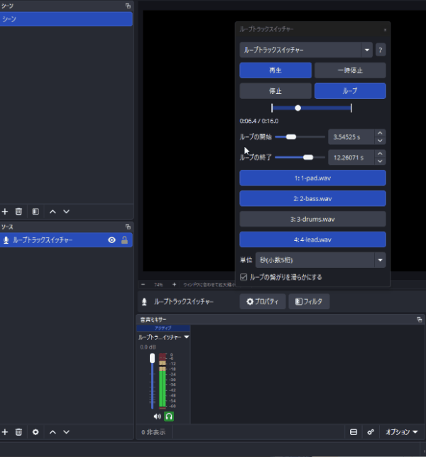

# ループトラックスイッチャー / Loop Track Switcher

OBS Studio 向けの、複数の音声トラックを同期してループ再生し、Dock からトラックを重ねたり外したりする音声ソースのプラグインです。配信の状況に合わせて BGM の楽器を増やしたり減らしたりする、インタラクティブミュージックのような使い方を想定しています。

An audio source plugin for OBS Studio that plays up to four audio tracks in sync as a loop and lets you add or remove tracks from a dock. It is meant for interactive music: adding or removing instruments of your background music to fit what happens on stream.

[配信プラグイン倉庫くん](https://soko-kun.allegromoltov.jp/plugins/allegromoltov/loop-track-switcher) にも掲載しています。 / Also listed on [Plugin Soko-kun](https://soko-kun.allegromoltov.jp/plugins/allegromoltov/loop-track-switcher?lang=en).



## Features / 機能

同じ曲から書き出した最大 4 つのトラック (ステム) を、1 つの再生位置で同期して再生します。トラックの ON/OFF は 200 ms のフェードで切り替わるため、途中で重ねても外しても拍がずれません。曲にイントロ・ループ・アウトロがあれば、イントロから再生してループの区間を繰り返し、ループを OFF にするとアウトロへ進んで曲の終わりで停止します。

操作は OBS の Dock で行います。プロパティの画面を開かずに、再生・一時停止・停止・ループの切り替え、トラックの ON/OFF、シークバーでの移動、ループの区間の設定ができます。Dock を閉じても再生は続きます。

処理の軽さを優先しています。音声ファイルは読み込むときに 48 kHz・ステレオ・16 ビットへそろえてメモリに置くため、再生中はトラックを足し合わせるだけです。このプラグインはネットワークに何も送りません。

Up to four tracks (stems) exported from the same song play in sync from one shared position. Track switches fade over 200 ms, so you can add or remove a track at any moment without losing the beat. If the song has an intro, a loop, and an outro, playback starts with the intro and repeats the loop; turning the loop off goes on into the outro and stops at the end of the song.

You operate the plugin from an OBS dock, without opening the properties: Play, Pause, Stop, the loop switch, the track switches, a seek bar, and the loop range. Closing the dock does not stop playback.

The plugin favors low processing cost. Audio files are converted to 48 kHz, stereo, 16-bit when they are loaded and kept in memory, so playback only adds the tracks together. The plugin sends nothing over the network.

- 読み込める音声ファイル / Audio files: WAV、MP3、FLAC、Ogg Vorbis。サンプリング周波数とチャンネル数は問いません / any sample rate and channel count
- トラック / Tracks: 最大 4 つ / up to four
- ループ / Loop: 曲全体で 1 つの区間。秒・ミリ秒・サンプルで指定できる / one range for the whole song, in seconds, milliseconds, or samples
- フェード / Fades: トラックの ON/OFF と再生・一時停止・停止は 200 ms、ループの繋がりは 10 ms のクロスフェード (ON/OFF 可) / 200 ms for switches and transport, a 10 ms crossfade at the loop seam (optional)

## Installation / インストール

### Windows

Windows 版は OBS Studio 31.1 以降向けにビルドしています。OBS Studio 33.0.3 で、導入、Dock の操作、形式の混在した音声ファイルの同期、再起動後の設定の保持を確認しています。

#### 通常版 OBS への導入

プラグインを OBS Studio の共通プラグインフォルダーへ配置します。

1. OBS Studio を終了してください。
2. [Releases](../../releases) から Windows 用の zip ファイルをダウンロードし、展開してください。
3. エクスプローラーのアドレスバーへ `%PROGRAMDATA%` を入力し、Enter キーを押してください。隠しフォルダーの表示設定を変更する必要はありません。
4. `obs-studio` フォルダーを開き、その中の `plugins` フォルダーを開いてください。存在しないフォルダーは順に作成してください。
5. 展開した `loop-track-switcher` フォルダーを `plugins` へコピーしてください。管理者の許可を求められた場合は許可してください。
6. OBS Studio を起動してください。

導入後の構成を次に示します。`loop-track-switcher` フォルダーを二重に作らないでください。PDB ファイルが同梱されている場合も、製品フォルダーごとコピーします。

```text
%PROGRAMDATA%\obs-studio\plugins\
└─ loop-track-switcher\
   ├─ loop-track-switcher.dll
   └─ data\
      ├─ licenses\
      │  ├─ dr_libs.txt
      │  ├─ r8brain-free-src.txt
      │  └─ stb_vorbis.txt
      └─ locale\
         ├─ en-US.ini
         └─ ja-JP.ini
```

更新するときは、OBS Studio を終了し、同じ手順で `loop-track-switcher` フォルダーを上書きコピーしてください。設定やシーンは削除しないでください。

#### ポータブル版 OBS

ポータブル版では、OBS Studio のルートフォルダーにある `plugins` へ製品フォルダーをコピーします。通常版の `%PROGRAMDATA%` への導入では読み込まれません。

OBS Studio を終了し、`bin` や `data` と同じ階層に `plugins` フォルダーを作成してください。展開した製品フォルダーをコピーし、`plugins\loop-track-switcher\loop-track-switcher.dll` と `plugins\loop-track-switcher\data` を配置してから OBS Studio を起動します。

### Linux

Ubuntu では、Releases の `loop-track-switcher-<version>-x86_64-linux-gnu.deb` を `sudo apt install ./<ファイル名>` で導入します。この .deb は、OBS Studio の公式の PPA (`ppa:obsproject/obs-studio`) から apt で導入した OBS Studio を前提にしています。

On Ubuntu, install `loop-track-switcher-<version>-x86_64-linux-gnu.deb` from Releases with `sudo apt install ./<file name>`. The package expects OBS Studio installed with apt from the official PPA (`ppa:obsproject/obs-studio`).

GitHub Actions 上の Ubuntu 24.04 で、音声ファイルの読み込みと、ソースの出力した音を自動で検証しています。作者は Linux の実機を持たないため、実機の OBS Studio と Dock の操作は確認していません。

### macOS

作者は macOS 版を提供していません。

### Verifying downloads / ダウンロードの検証

Releases のファイルは、このリポジトリの GitHub Actions でビルドし、ビルドの来歴の証明 (artifact attestation) を付けています。[GitHub CLI](https://cli.github.com/) で、ダウンロードしたファイルがこのリポジトリのワークフローで作られたことを確かめられます。

Every release file is built by the GitHub Actions workflow of this repository and carries a build provenance attestation. With the GitHub CLI, you can confirm that a downloaded file was built by this repository's workflow.

```bash
gh attestation verify <ダウンロードしたファイル / downloaded file> --repo AllegroMoltoV/loop-track-switcher
```

## Usage / 使い方

1. メニューの「ドック」から「ループトラックスイッチャー」の Dock を表示します。右上の「?」に、最初にすることの案内があります。
2. ソースの「+」から「ループトラックスイッチャー」を追加し、プロパティでトラック 1〜4 に音声ファイルを指定して「OK」を押します。
3. Dock の一覧で、追加したソースを選びます。
4. ループの開始と終了を、スライダーか数値の欄で指定します。終了を曲の終わりにすると、曲全体をループします。
5. 「再生」を押すと、曲の頭から再生が始まります。再生中に、トラックのボタンで ON/OFF を切り替えます。
6. 「ループ」を OFF にすると、次にループの終端に達したところでアウトロへ進み、曲の終わりで停止します。

1. Show the Loop Track Switcher dock from the Docks menu. The "?" button at the top right explains what to do first.
2. Add a Loop Track Switcher source with the + button in the Sources list, choose audio files for tracks 1 to 4 in its properties, and press OK.
3. Pick the source in the list of the dock.
4. Set the loop start and end with the sliders or the number fields. Setting the end to the end of the song loops the whole song.
5. Press Play to start from the beginning of the song. While it plays, switch tracks on and off with the track buttons.
6. Turn the loop off to go on into the outro at the next loop end and stop at the end of the song.

同じ曲から、同じ長さ・同じ開始位置で書き出したステムを使ってください。ループの継ぎ目に音の段差があるとクリック音が出ることがあります。「ループの繋がりを滑らかにする」を ON にすると、継ぎ目に 10 ms のクロスフェードをかけて段差を抑えます。

Use stems exported from the same song with the same length and start. A step in the waveform at the loop seam can cause a click; "Smooth the loop seam" adds a 10 ms crossfade there.

## Dock / ドック

| 部品 / Part | 説明 / Description |
| --- | --- |
| ソースの一覧 / Source list | 操作するソースを選ぶ / the source to operate |
| 再生・一時停止・停止 / Play, Pause, Stop | いまの状態のボタンが強調される / the button of the current state is highlighted |
| ループ / Loop | ON の間はループする。OFF にするとアウトロへ進み、曲の終わりで停止する / loops while on; when off, plays the outro and stops |
| シークバー / Seek bar | 再生位置と、イントロ・ループ・アウトロの区間を表示する。クリックかドラッグで移動する / shows the position and the intro, loop, and outro; click or drag to seek |
| ループの開始・終了 / Loop start, end | スライダーと数値の欄で指定する / set with the sliders or the number fields |
| トラック 1〜4 / Tracks 1-4 | ON/OFF を切り替える / switch tracks on and off |
| 単位 / Unit | ループの位置の単位。秒 (小数 5 桁)・ミリ秒・サンプル / seconds (5 decimals), milliseconds, or samples |
| ループの繋がりを滑らかにする / Smooth the loop seam | 継ぎ目の 10 ms のクロスフェード / the 10 ms crossfade at the loop seam |

トラックの横やループの終了の横に警告のアイコンが出たときは、マウスを重ねると理由が表示されます。長さの違うトラック、10 分を超えるトラック、3 チャンネル以上のトラック、読み込めないファイルでも再生は続きます。

When a warning icon appears next to a track or the loop end, hover over it to see the reason. Playback goes on with tracks of different lengths, tracks longer than 10 minutes, tracks with three or more channels, and files that cannot be read.

## Known Behavior / 既知の挙動

- 曲の終わりは、読み込んだトラックのうち最も長いトラックの終わりです。短いトラックは、自分の終わりより後ろで無音になります。
- 1 つのトラックは 10 分までです。10 分を超える部分は読み込みません。
- 3 チャンネル以上の音声ファイルは、前方の左右のチャンネルだけを使います。モノラルは左右に同じ音を出します。
- 再生の状態 (再生中・一時停止中) は保存しません。OBS を起動したときは停止した状態から始まります。トラックとループの ON/OFF、ループの区間、ループの繋がりの設定は保存します。
- 再生中は、どのシーンに表示されているかに関係なく再生位置が進みます。シーンに出ていない間の音は、OBS の仕様で配信・録画に出ません。
- The end of the song is the end of the longest loaded track. A shorter track is silent after its own end.
- A track is loaded up to 10 minutes. The rest is not loaded.
- For three or more channels, only the front left and front right are used. Mono plays the same sound on both sides.
- The playing state is not saved, so the source starts stopped when OBS starts. The track and loop switches, the loop range, and the seam setting are saved.
- The position advances whether or not the source is shown in a scene. OBS does not send the sound of a source that is not shown to the stream or the recording.

## Memory and Files / メモリとファイル

音声ファイルは読み込むときに 48 kHz・ステレオ・16 ビットへそろえてメモリに置きます。メモリの量は、1 トラック 1 分あたり約 11.5 MB です。4 トラックとも 10 分の上限のときは約 440 MB になります。同じファイルを複数のソースで使うと、メモリは共有されます。プロパティの画面に、そのソースが使うメモリの量が表示されます。

48 kHz の WAV 以外の音声ファイルは、変換した結果を次のフォルダーに保存し、次に OBS を起動したときの読み込みを速くします。30 日使われなかったファイルは、OBS の起動時に削除されます。ソースを削除したときも、ほかのソースで使っていなければ削除されます。

```text
Windows: %APPDATA%\obs-studio\plugin_config\loop-track-switcher\bakes\
Linux:   ~/.config/obs-studio/plugin_config/loop-track-switcher/bakes/
```

Audio files are converted to 48 kHz, stereo, 16-bit when they are loaded and kept in memory: about 11.5 MB per track per minute, or about 440 MB when all four tracks reach the 10-minute limit. Sources that use the same file share the memory. The properties show how much memory the source uses.

Files other than 48 kHz WAV are converted once, and the result is saved in the folder above so that the next start of OBS loads them faster. Saved files that were not used for 30 days are deleted when OBS starts, and a source's files are deleted when you remove the source, unless another source uses them.

## Build / ビルド

### Requirements / 必要環境

| Platform | Tool |
|----------|------|
| Windows | Visual Studio 17 2022, CMake 3.28+ |
| Ubuntu 24.04 | ninja-build, pkg-config, build-essential, CMake 3.28+ |

### Build Commands / ビルドコマンド

```bash
# Windows
cmake --preset windows-x64
cmake --build build_x64 --config RelWithDebInfo

# Ubuntu
cmake --preset ubuntu-x86_64
cmake --build build_x86_64 --config RelWithDebInfo
```

Windows で生成物を取り出すには、`cmake --install build_x64 --config RelWithDebInfo --prefix release/RelWithDebInfo` を実行してください。生成した製品フォルダーを前述の手順で導入してください。

テストは CTest に登録しています。`ctest --test-dir build_x64 -C RelWithDebInfo` で、再生のエンジンと音声ファイルの読み込みの単体テストと、libobs にプラグインを読み込む結合テストを実行します。

The tests are registered with CTest. `ctest --test-dir build_x64 -C RelWithDebInfo` runs the unit test of the playback engine and the audio loader, and the scenario test that loads the plugin into libobs.

## Third-Party Code / 第三者のコード

`src/third-party/` に、次のコードを変更せずに同梱しています。版とコミットは `src/third-party/README.md` に、ライセンスの全文は `data/licenses/` にあります。

The following code is bundled unchanged in `src/third-party/`. The versions and commits are in `src/third-party/README.md`, and the full license texts are in `data/licenses/`.

| Code | Version | License | Use |
| --- | --- | --- | --- |
| [dr_wav, dr_flac, dr_mp3](https://github.com/mackron/dr_libs) (David Reid) | 0.14.6, 0.13.4, 0.7.4 | Public domain or MIT-0 | WAV、FLAC、MP3 の読み込み / decoding |
| [stb_vorbis](https://github.com/nothings/stb) (Sean Barrett) | 1.25 | Public domain or MIT | Ogg Vorbis の読み込み / decoding |
| [r8brain-free-src](https://github.com/avaneev/r8brain-free-src) (Aleksey Vaneev) | 7.7 | MIT (includes Takuya Ooura's FFT) | サンプリング周波数の変換 / sample rate conversion |

テストの音声ファイル (`tests/data/`) は、`tests/data/make-fixtures.py` で合成した音を ffmpeg で書き出したもので、第三者の素材を含みません。

The audio files for the tests (`tests/data/`) were synthesized by `tests/data/make-fixtures.py` and encoded with ffmpeg. They contain no third-party material.

## AI利用開示 / AI Disclosure

### 日本語

v1.0.0 の制作では、Anthropic Claude Code を、調査、ソースコード、ビルド設定、テスト、文書を含むほぼすべての工程で使用しました。リソースアイコンは、Claude Code が作成した SVG の案から、作者本人が選びました。

作者本人は Windows 上の OBS Studio でユーザーテストを実施しました。コード読解による厳密な人間レビューは実施していません。概要説明欄のアニメーション GIF は、作者本人が画面収録したもので、生成 AI を使用していません。

### English

Anthropic Claude Code was used for almost the entire development process of v1.0.0, including research, source code, build configuration, tests, and documentation. The resource icon was chosen by the author from SVG candidates that Claude Code drew.

The author performed user testing in OBS Studio on Windows but did not perform a rigorous human review of the source code. The animated GIF in the description was screen-recorded by the author, without generative AI.

## License / ライセンス

GPL-2.0 License (GPL-2.0-or-later)

このプラグインは [obs-plugintemplate](https://github.com/obsproject/obs-plugintemplate) をベースにしています。

## Author / 作者

AllegroMoltoV - https://www.allegromoltov.jp

## Changelog / 更新情報

### v1.0.0

- 最初の公開版です。
