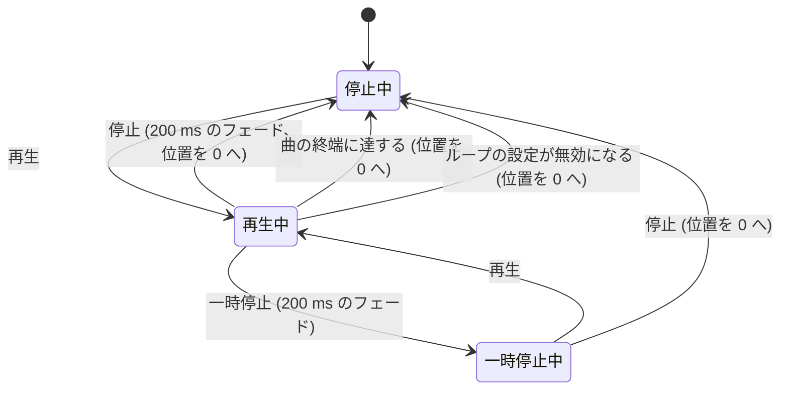

# 再生の状態遷移

ループトラックスイッチャーのソース 1 つが持つ再生の状態と、操作や再生の進行による遷移を定めます。Dock の表示と操作、エンジンの実装、テストは、この文書に従います。

## 用語

| 用語 | 定義 |
| --- | --- |
| 再生位置 | 全トラックで共有する 1 つの位置。サンプル数で持ち、シークバーと Dock には秒で表示する |
| 曲の終端 | 読み込んだトラックのうち最も長いトラックの終端 |
| ループの開始 | Dock で指定する位置。内部ではサンプル数で持つ |
| ループの終端 | Dock で指定する位置。内部ではサンプル数で持つ。0 は曲の終端を表す |
| イントロ | 区間 [0, ループの開始) |
| ループ | 区間 [ループの開始, ループの終端) |
| アウトロ | 区間 [ループの終端, 曲の終端)。ループの終端が曲の終端と同じときは存在しない |
| ループのボタン | Dock の「ループ」のトグルボタン。再生・一時停止・停止のボタンと同じ形で並べ、ON のときは色を付ける。ON のときは、再生位置がループの終端に達するとループの開始へ戻る。OFF のときは、戻らずにアウトロへ進む |
| 発音中 | 音が出ている期間。再生中と、一時停止・停止のフェードアウトの最中を合わせた期間 |
| フェード | 音量を線形に変える処理。トラックの ON/OFF、再生、一時停止、停止では 200 ms、発音中のシークでは 10 ms |
| 継ぎ目のクロスフェード | ループの終端の直前 10 ms に、ループの開始の直前 10 ms の音を線形に重ねる処理。ループの開始へ戻るときのクリック音を抑える。Dock の「ループの繋がりを滑らかにする」で ON/OFF を選び、既定は ON |

## 状態

再生の状態は 3 つです。再生位置がどの区間にあるかと、ループのボタンの ON/OFF は、状態とは別に持ちます。

| 状態 | 再生位置 | 出力 |
| --- | --- | --- |
| 停止中 | 0、またはシークで指定した位置 | 無音 |
| 再生中 | 進む | トラックの加算 |
| 一時停止中 | 保つ | 無音 |

一時停止と停止の 200 ms のフェードの間は、出力が小さくなりながら再生位置が進みます。この間、Dock は操作後の状態を表示します。

## 遷移

### 操作による遷移

| 操作 | 停止中 | 再生中 | 一時停止中 |
| --- | --- | --- | --- |
| 再生 | 今の再生位置から再生中へ。200 ms でフェードイン | 変化なし | 保った位置から再生中へ。200 ms でフェードイン |
| 一時停止 | 変化なし | 200 ms でフェードアウトし、一時停止中へ。位置を保つ | 変化なし |
| 停止 | 位置を 0 にする | 200 ms でフェードアウトし、停止中へ。位置を 0 にする | 停止中へ。位置を 0 にする |
| シーク | 位置を変える | 10 ms でフェードアウトし、位置を変えて 10 ms でフェードインする | 位置を変える |
| ループのボタンの ON/OFF | 切り替える | 切り替える | 切り替える |
| トラックの ON/OFF | 切り替える | 200 ms のフェードで切り替える | 切り替える |

表の停止中と一時停止中の列は、発音中でないときの動作です。フェードアウトの最中のシークは、再生中の列と同じく 10 ms のフェードで位置を変えます。シークのフェードは、再生・一時停止・停止のフェードとは別に掛け合わせます。そのため、シークのフェードの最中に再生・一時停止・停止を操作しても、それぞれのフェードは並行して進みます。

シークの位置は、0 以上、曲の終端未満に丸めます。停止中の再生位置は、停止へ移る瞬間と停止の操作の時点で 0 になり、それ以外では変わりません。そのため、停止中にシークした位置から再生できます。

### 再生の進行による遷移

| 再生位置の到達点 | ループのボタン | 結果 |
| --- | --- | --- |
| ループの終端 | ON | ループの開始へ戻り、再生を続ける |
| ループの終端 | OFF | 戻らずにアウトロへ進む |
| 曲の終端 | どちらでも | 停止中へ。位置を 0 にする。フェードはかけず、その時点で出力を無音にする |

継ぎ目のクロスフェードが ON で、ループのボタンが ON のときは、ループの終端の直前 10 ms の間、位置 p の音に、位置 p - (ループの終端 - ループの開始) の音を重ねます。重ねる割合は 0 から 1 へ線形に増やします。ループの開始が 10 ms より前にあるときは、重ねる長さをループの開始までに縮めます。ループのボタンが OFF のときは重ねません。

ループの終端が曲の終端と同じでアウトロが無いときに、ループのボタンが OFF のままループの終端に達すると、その時点で停止します。

アウトロの区間では、ループのボタンの ON/OFF にかかわらず曲の終端まで再生して停止します。シークでアウトロの区間に入った場合と、アウトロの区間でループのボタンを ON に戻した場合も同じです。アウトロの区間で一時停止し、再び再生すると、アウトロの続きから再生します。

### ループのボタンの保持

ループのボタンの ON/OFF は、利用者が操作したときだけ変わります。停止、曲の終端での停止、エラーによる停止では変わりません。OFF のまま停止中から再生すると、イントロとループを 1 回ずつ再生してアウトロへ進み、曲の終端で停止します。

ループのボタンの ON/OFF は、トラックの ON/OFF と同じくシーンコレクションに保存し、OBS の起動時に復元します。新しく作ったソースでは ON です。

## トラックとループの設定の検査

ループの設定とトラックの組み合わせを、トラックの読み込みとループの値の変更のたびに検査します。結果は、再生を止めるエラーと、再生を止めない警告に分かれます。検査は、次の 2 つの場合を除いて再生位置を変えません。

- トラックの差し替えで曲の終端が短くなり、再生位置がそれ以上になった場合は、曲の終端に達したものとして扱う
- ループの区間を再生している最中に、ループの終端が再生位置以下へ動いた場合は、ループのボタンが ON ならループの開始へ戻す。OFF ならアウトロへ進んだものとして扱う。アウトロの区間を再生しているときは位置を変えない

| 条件 | 種別 | 表示する場所 | 動作 |
| --- | --- | --- | --- |
| 読み込まれたトラックが無い | エラー | [!] は出さない。再生のボタンとループのスライダーを押せない状態にする | 再生できない。再生中なら停止中へ |
| ループの開始がループの終端以上 | エラー | Dock の入力では起きない。保存された値などで起きたときは、ループの開始と終了の横 | 同上 |
| ループの終端が曲の終端を超える | エラー | ループの終了の横 | 同上 |
| トラックが曲の終端より短い | 警告 | そのトラックの横 | 再生できる。そのトラックは自分の終端より後ろで無音になる |
| トラックの読み込みに失敗した | 警告 | そのトラックの横 | そのトラックを無音として再生できる |
| トラックが 10 分を超える | 警告 | そのトラックの横 | 10 分で切り捨てて再生できる |
| トラックが 3 チャンネル以上 | 警告 | そのトラックの横 | 前方の左右の 2 チャンネルだけで再生できる |

エラーはエンジンが判定します。警告は、トラックごとの長さと読み込みの状態から Dock が判定します。Dock は、該当する場所に警告のアイコン (以下 [!] と書く) を表示し、問題が無い場所には表示しません。アイコンは Qt の標準の警告アイコンで、OS とテーマに合わせて描かれます。[!] にマウスを重ねると理由を表示します。長さの警告では、そのトラックの長さと曲の終端を表示します。

## Dock

この節は、再生の状態と遷移にかかわる Dock の表示と操作だけを定めます。

| 部品 | 表示と操作 |
| --- | --- |
| [?] のボタン | 右上に置く。マウスを重ねるかクリックすると、ソースの一覧の「+」からこのソースを追加し、プロパティで WAV を指定する手順を表示する |
| ソースの一覧 | 操作するソースを選ぶ |
| 再生・一時停止・停止・ループ | 2 行 2 列のボタン。今の状態に対応するボタン (再生中は再生、一時停止中は一時停止、停止中は停止) と、ON のときのループを、OBS のテーマの強調色で強調する。状態の文字は表示しない |
| シークバー | 0 から曲の終端までを表す。現在の再生位置を 100 ms ごとに表示し、その下に再生位置と曲の終端を表示する。クリックした時点と、ドラッグを離した時点でシークする。ドラッグの間は再生位置の表示を更新せず、つまみをマウスの位置に表示する。ループの開始と終端に印を付け、イントロ・ループ・アウトロの区間を色で区別する。ループの値はシークバーでは変えない |
| ループの開始・終了 | それぞれスライダーと数値の欄を持つ。値はスライダーを離したときと、数値の欄で確定したとき (Enter キー、またはフォーカスが外れたとき) に反映する。開始の範囲は 0 から終了の 1 サンプル手前まで、終了の範囲は開始の 1 サンプル後ろから曲の終端まで。エラーのときは該当する行の横に [!] を表示する |
| トラック | 4 行。行ごとに ON/OFF のボタンとファイル名を表示し、警告のときは横に [!] を表示する |
| 単位 | 下部のプルダウン。ループの開始・終了の表示と入力の単位を、秒 (小数 5 桁)・ミリ秒・サンプルから選ぶ。内部の値はサンプル数のまま変わらない。Dock 全体の設定として保存する |
| ループの繋がりを滑らかにする | 下部の単位のプルダウンの下の行に置くチェックボックス。継ぎ目のクロスフェードの ON/OFF。ソースごとの設定で、既定は ON |

ループの開始と終了は Dock だけで編集し、プロパティには表示しません。プロパティ画面はキャンセルのときに開いた時点の設定をまるごと戻すため、両方で編集できると Dock の変更が巻き戻るためです。ループの値と継ぎ目のクロスフェードは、トラックの ON/OFF と同じくシーンコレクションに保存し、起動時に復元します。

## 決定の状況

次の事項は、2026-11-25 に依頼者が決めました。

| ID | 内容 |
| --- | --- |
| D1 | ループのボタンの ON/OFF は利用者の操作でだけ変わる。停止では変わらない |
| D2 | アウトロの区間でループのボタンを ON に戻しても、アウトロを曲の終端まで再生して停止する |
| D3 | 曲の終端は、最も長いトラックの終端とする |
| D4 | ループのボタンの ON/OFF はシーンコレクションに保存し、起動時に復元する |
| P1 | アウトロの区間で一時停止し、再生すると、アウトロの続きから再生する |
| P2 | シークでアウトロの区間に入ると、ループのボタンにかかわらずアウトロを再生して停止する |
| P3 | シークバーにループの開始と終端の印を付け、区間を色で区別する |
| F1 | 長さの違うトラックは警告のみで再生できる |
| F2 | シークはどの状態でもできる。発音中は短いフェードをかける |
| U1 | 警告の [!] は、そのトラックの横に表示する。トラックに属さないエラーは、ループの区間の行の横に表示する |
| U2 | アウトロへの進行は「ループ」のトグルボタンで操作する。ON の間はループする。ボタンは再生・一時停止・停止と同じ形で並べ、ON のときは強調する |
| U3 | 状態は文字で表示せず、ボタンの強調で伝える |
| U4 | ループの開始と終了は Dock のスライダーと数値の欄で設定し、Dock だけで編集する |
| U5 | ループの値の単位は、秒 (小数 5 桁)・ミリ秒・サンプルから Dock で選ぶ |
| U6 | 継ぎ目のクロスフェードを Dock の「ループの繋がりを滑らかにする」で ON/OFF でき、既定は ON。単位のプルダウンとは行を分ける |
| U7 | ループの区間を再生中にループの終端を再生位置以下へ動かすと、ループが ON ならループの開始へ戻る |
| U8 | 右上の [?] で、まずソースを作ることを案内する。ボタンは 2 行、トラックは 4 行 |
| U9 | ループの開始と終了の入力範囲を互いに制限し、開始が終了以上になる値を入力できないようにする。トラックが無いときは [!] を出さず、再生のボタンとループのスライダーを押せない状態にする |
| U10 | [!] は文字列ではなく、Qt の標準の警告アイコンで表示する (2026-11-25 依頼者の試用のご意見) |
